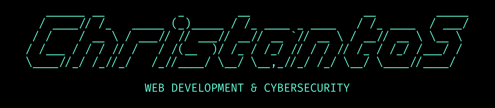

                                                           

<!-- Badge -->

  <!-- Visitor Counter (laobi badge) -->
  
  <!-- Repository Counter (shield.io) -->
  

<!-- Github Stats -->

  <tr>
    <td>
      
    </td>
    <!-- <td>
      
    </td> -->
  </tr>

<!-- Main Content -->
<h1 align="center"><strong>Stack & Software</strong></h2>
<!-- Language -->

   &ensp;
   &ensp;
   &ensp;
   &ensp;
  

<!-- Software -->

   &ensp;
   &ensp;

 

<!-- Social Media -->
<h1 align="center"><strong>Communicate & Collab</strong></h2>

    &emsp;
    &emsp;
    &emsp;
